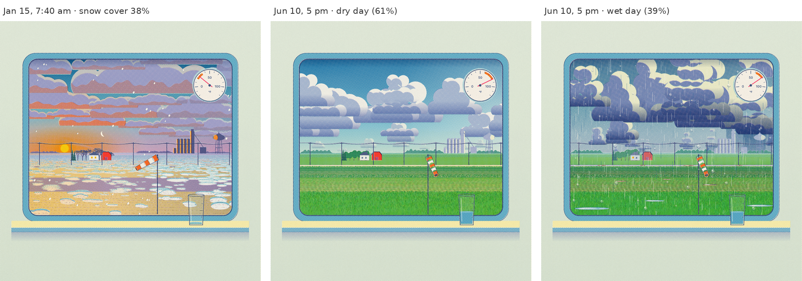

<div align="center">

# Urbana Weather Window

A year-round weather calendar for Urbana, Illinois, built around a code-drawn risograph window.<br>
The window shows a typical day at any date and hour, from 1991–2020 normals and station records. It's not a forecast.

[**Speed test**](https://claude.ai/artifact/Cy1hdQT8K4y1F9PBB9qkdp) &nbsp;·&nbsp;
[**Approved frames**](reference/frames/) &nbsp;·&nbsp;
[**Run the checks**](#run-the-checks) &nbsp;·&nbsp;
[**Climate data**](data/urbana_climate.json) &nbsp;·&nbsp;
[**Project log**](.claude/context/LOG.md)

<br>



<sub>Every mark is data: sun and moon, clouds, snow, windsock, thermometer, and the rain glass on the sill.</sub>

</div>

> [!NOTE]
> The renderer matches the three approved frames. The calendar page isn't built yet, so there's no public demo. The newest entry in the [project log](.claude/context/LOG.md) has the current status.

## Links

| Link | What it is |
| :--- | :--- |
| [**Speed test**](https://claude.ai/artifact/Cy1hdQT8K4y1F9PBB9qkdp) | Renders the three frames live in your browser, CPU and WebGL prints side by side, and times both. Private claude.ai page for now. |
| [**Approved frames**](reference/frames/) | The target images. The renderer has to reproduce them. |
| [**Climate data**](data/urbana_climate.json) | Climatology for all 366 days, built from the raw records by [`build_data.py`](pipeline/build_data.py). |
| [**Project log**](.claude/context/LOG.md) | What changed each session, what was decided, and what's still open. |
| [**Dev guide**](CLAUDE.md) | Commands, architecture, constraints and pitfalls. |
| [**Renderer**](renderer/riso-window.js) | `RisoWindow.renderWindow(canvas, params)`. Paints the scene onto 8 ink plates, then prints them as halftones on paper. |
| [**Test harness**](renderer/test.html) | Renders one frame from the params in its URL hash. The checks run it. |
| [**Frame params**](tools/frames.json) | The inputs behind each approved frame. |
| [**Handoff**](HANDOFF.md) | The original brief. Partly out of date; where it and the log disagree, trust the log. |

## Run the checks

You need Python 3 with `numpy`, `pillow` and Playwright. The [dev guide](CLAUDE.md#commands) has the setup notes and the rest of the commands.

```bash
python3 tools/check_frames.py           # render every frame and diff it against its approved image
python3 tools/check_frames.py --webgl   # also check the WebGL print against the CPU print
python3 tools/bench.py                  # build the speed test page at tools/out/bench.html
```

A frame passes when its mean pixel difference from the approved image is under 1.0/255. The WebGL print must stay within 2.0/255 of the CPU print.

## Data

| Source | What it gives |
| :--- | :--- |
| [NOAA U.S. Climate Normals](https://www.ncei.noaa.gov/products/land-based-station/us-climate-normals), 1991–2020 | Daily and monthly normals for Champaign 3S (USC00118740) |
| [ACIS](https://www.rcc-acis.org/) daily record, 1888–present | Records, percentiles, and freeze and snow dates for the same station |
| [NOAA ISD](https://www.ncei.noaa.gov/products/land-based-station/integrated-surface-database) hourly, 2006–2025 | Wind, gusts and dew point at Willard Airport (KCMI) |
| [NASA POWER](https://power.larc.nasa.gov/) daily, 2001–2025 | Cloud cover |
